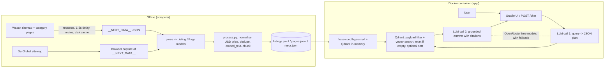

# Property Assistant: DarGlobal + Wasalt

A chatbot that answers questions about real-estate data scraped from
**DarGlobal** (darglobal.co.uk, a luxury/branded developer) and **Wasalt**
(wasalt.sa, a Saudi listings portal). It combines structured filters
(city, type, price, bedrooms) with semantic search, and answers only from the
retrieved records, citing their URLs.

- **Live demo:** `<your HF Space URL>`
- **API:** `POST /chat`, `GET /health` (same host)

## Try these

1. *Who is DarGlobal and which countries do they have projects in?*
2. *Show me apartments for sale in Riyadh under 1,000,000 SAR*, then *What about cheaper ones in Jeddah?*
3. *Which DarGlobal projects are in Dubai and when do they hand over?*
4. *What is the cheapest apartment for rent in Dammam?*
5. *How do I get residency by buying property in Saudi Arabia or the UAE?*

## Architecture



## How the scraping works

Both sites are Next.js apps that embed the full page data as JSON in
`<script id="__NEXT_DATA__">`, so neither needs HTML parsing or a headless browser.

**Wasalt** (`scrapers/wasalt.py`): robots.txt allows everything except `/search`.
`get_urls()` reads category result pages (apartments/villas for sale, properties
for rent) for Riyadh, Jeddah and Dammam; each server-renders 32 listings. (SSR
ignores `?page=N`, so we vary the category instead of paginating.) `fetch()` gets
each listing page through a shared layer (`scrapers/common.py`): 1–2 s random
delay, `tenacity` exponential backoff on 429/5xx, an honest self-identifying
User-Agent, and a disk cache in `data/raw/wasalt/<sha1>.html`, so re-parsing
never re-hits the site. `parse()` maps `propertyDetailsV3` to the `Listing`
model. Agent and owner names are never stored, and phone numbers are scrubbed
from descriptions.

**DarGlobal** (`scrapers/darglobal.py`): `sitemap.xml` is fetchable and gives
about 480 URLs, of which we keep project and company pages (no blog/press). The
HTML pages sit behind **Imperva/Incapsula**, which answers non-browser clients
with a JavaScript challenge. I chose **not** to work around that from a script
(no stealth browsers, no cookie replay). Instead `scrapers/capture_darglobal.js`
runs once in a normal browser tab on the site. It fetches the ~60 pages
same-origin, 1.5 s apart, reads each page's own `__NEXT_DATA__` (Strapi CMS
records), condenses it, and the result is saved to
`data/raw/darglobal/_projects.json` and `_index_and_pages.json`. The Python
parser works only from that cache. DarGlobal publishes **no prices** online
(`StartingPrice` is null on every project), so prices are `null` with
`price_text = "Price on request"`. Unit ranges ("1, 2 & 3-bedrooms",
"Area (SQFT): 701 - 7,627") become `bedrooms_min/max` and `area_sqm_min/max`.

Company pages (About, FAQ, Why Invest, Hospitality, Tokenization, AIDA 360,
Development Management, ...) plus each project's FAQ are stored as `pages` so the
bot can answer "who is DarGlobal" and "how do I get residency" questions.

`python -m scrapers.report` prints counts per source and the null % per field.

## Data processing (`scrapers/process.py`)

- City names are canonicalised (case, Arabic → English); property types are
  normalised to apartment / villa / land / hotel / ...
- `price_usd` uses **fixed rates** (snapshot): SAR 0.2667, AED 0.2723,
  QAR 0.2747, OMR 2.6008, GBP 1.27, EUR 1.08. The original price and currency are kept.
- Deduped on URL, then on (title, price, area).
- `embed_text`: a readable paragraph per listing ("3 bedroom Apartment in
  Al-Malqa, Riyadh, Saudi Arabia. For sale: SAR 1,450,000. Area 180 sqm. ...").
- Pages are chunked to ~400 tokens with ~50 tokens of overlap.

## Key decisions

- **Hybrid retrieval**: an LLM turns the question into a validated JSON plan
  (intent, city, type, sale/rent, price bounds and currency, bedrooms, source,
  sort, and a standalone `rewritten_query` for follow-ups). Qdrant applies payload
  filters and vector similarity in one query. If nothing matches, filters are
  relaxed in order (bedrooms → price → type → sale/rent) and the answer says so.
  "Cheapest/largest" re-sorts a wider candidate set numerically.
- **Robust to flaky free models**: the plan is validated with Pydantic, retried
  once, then falls back to plain vector search. LLM calls walk a model list
  (`OPENROUTER_MODELS`) on 429/timeout/5xx. If no model answers, the bot still
  returns the retrieved listings, clearly labelled.
- **Small image**: `fastembed` (ONNX, no PyTorch) + Qdrant local mode gives one
  process, one port, no DB container. The embedding model is baked into the image,
  and the index is built at startup in a few seconds.
- **Grounding**: the answer prompt requires context-only answers, URL citations,
  and "price on request" instead of guessed prices.

## Run locally

```bash
docker build -t darglobal-bot .
docker run -p 7860:7860 -e OPENROUTER_API_KEY=sk-or-... darglobal-bot
# open http://localhost:7860
```

Without Docker:

```bash
python -m venv .venv && .venv/Scripts/pip install -r requirements.txt   # (bin/ on macOS/Linux)
python -m scrapers.run wasalt       # re-scrape Wasalt (cached pages are reused)
python -m scrapers.run darglobal    # re-parse the DarGlobal capture
python -m scrapers.process && python -m scrapers.report
python -m app.index                 # precompute document vectors (keeps server RAM ~350 MB)
OPENROUTER_API_KEY=... uvicorn app.main:app --port 7860
OPENROUTER_API_KEY=... python -m eval.run_eval   # 19 eval questions -> eval/results.md
```

Env vars: `OPENROUTER_API_KEY` (required for LLM answers), `PLANNER` (`llm` default,
`hybrid` to save calls), `OPENROUTER_MODELS` (comma-separated fallback list; default
`nvidia/nemotron-3.5-super-vl:free,google/gemma-4-31b-it:free,deepseek/deepseek-v4-flash-0731`).

## Deploy

**Render (free, used for the live demo):** `render.yaml` is a Blueprint for a free
Docker web service. In Render choose New → Blueprint, pick this repo, and paste
`OPENROUTER_API_KEY` when asked. The free plan has 512 MB of RAM, which the app fits
because document vectors are precomputed (about 350 MB peak). It sleeps after 15 minutes
idle, so the first request after that takes about a minute.

**Hugging Face Spaces (needs PRO for Docker Spaces):** this README's YAML header sets
`sdk: docker` and `app_port: 7860`, and the container runs as UID 1000 as Spaces requires.
`hf auth login`, then `python deploy_space.py` creates the Space, stores the key as a
secret and uploads the app.

`LLM_DAILY_LIMIT` (default 600 calls, about $0.15 on the default models) caps spend on a
public link. Past it the bot answers with the retrieved listings only.

## Limitations

- **Snapshot**: data as of the scrape date shown in the UI header. Listings change daily.
- **Coverage**: 248 Wasalt listings after dedupe (265 scraped; Riyadh, Jeddah, Dammam ×
  apartments for sale / villas for sale / rentals), 40 DarGlobal projects and 48 company-page
  chunks. Enough to show the system works, not a full market view.
- **Source data quirks**: Wasalt has no amenities on these listings and some agent-entered
  sizes and rent periods look implausible (e.g. a 1,097 sqm one-bedroom). They are kept as published.
- **DarGlobal prices** aren't published, so price filters only ever match Wasalt listings.
- **Currency conversion** uses fixed rates and is approximate.
- **DarGlobal capture** is a one-off browser step because of the bot challenge, so
  refreshing it is semi-manual. A few "One of One" sub-pages render only generic
  collection text, so those projects have sparse details.
- **Free models first**: answers come from free OpenRouter models (Nemotron 3.5 Super, then
  Gemma 4 31B). Free models are rate-limited (per minute, and 50 or 1,000 requests a day
  depending on account credits), so a cheap paid model (DeepSeek V4 Flash, about $0.0005
  per turn) is the last fallback to keep the public link working. Once the daily free
  quota is gone, the bot skips free models until midnight UTC. `PLANNER=hybrid` saves calls
  by letting the rule-based planner handle clear first-turn questions. If no model answers,
  the bot replies instantly with the retrieved listings and a clear "model unavailable"
  label rather than failing.
